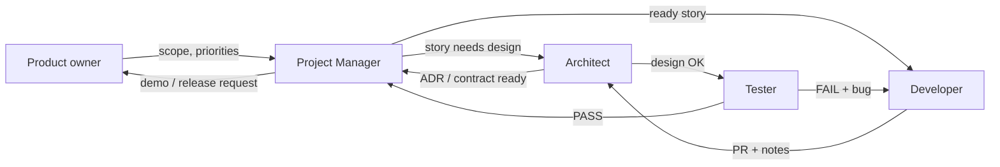

# Factory workflow

## Roles and gates

## Story lifecycle

| State | Owner | Exit criterion |
|---|---|---|
| Backlog | PM | Story written from template |
| Ready for design | Architect | ADR/contract updated, or "no design impact" noted |
| Ready for dev | Developer | Acceptance criteria + design complete |
| In review | Architect | PR conforms to ADRs/contract |
| In test | Tester | Test plan executed, verdict recorded |
| Done | PM | Definition of Done in `CLAUDE.md` satisfied |

## Sprint loop (run by the PM)
1. **Plan:** pick stories, check they are Ready, write `status/sprint-NN-plan.md`.
2. **Design:** Architect clears design questions for the sprint's stories.
3. **Build:** Developer implements story by story, writing tests first for calculations.
4. **Review:** Architect checks the PR.
5. **Verify:** Tester runs the plan and the oracle, then gives PASS/FAIL.
6. **Report:** PM writes the status report and demo notes, and lists decisions needed.
7. **Product owner review:** approves, or sends back with comments.

## Escalation
- Scope question → PM → product owner
- Design conflict → Architect writes an ADR → product owner approves if it is cost- or scope-relevant
- Disputed calculation → Tester and Architect check `02-tco-model-dk.md`; if the model itself is wrong, the product owner decides

## Product owner approvals required for
- The final choice of data sources (license implications)
- Any ADR that changes cost, region or stack
- Each production release from v1.0.0 onward (before v1.0.0, merges to `main` deploy to `prod` automatically; see ADR-004)
