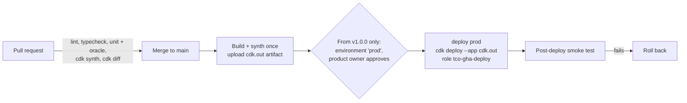

# ADR-004: Environments, CI/CD and IaC layout

**Status:** Accepted (approved by the product owner under **D-10**, 2026-11-23) · **Date:** 2026-11-21, revised 2026-11-23

| Decision | Status |
|---|---|
| **D-01** AWS account exists: a regular account in the advanced AWS experience (not a "project"), used in `eu-west-1`. Account ID stays out of the repo (placeholder `<ACCOUNT>`) | Resolved by the product owner, 2026-11-23 |
| **D-13** Until v1.0.0, agents may write to AWS, including local `cdk deploy` to `prod`, with CLI profile `tco-cars` (an admin IAM user created by the product owner) and the AWS MCP server. From v1.0.0, agent access is read-only and every prod change goes through CI with product owner approval | Decided by the product owner, 2026-11-23 |
| **D-02** Region: `eu-west-1` (Ireland) | Decided by the product owner, 2026-11-21 |
| **D-03** One AWS account, one stage (`prod`), no `dev` stage | Decided by the product owner, 2026-11-21 |
| **D-06** The product owner approves prod deploys from v1.0.0 onward. Before v1.0.0 there is no gate | Decided by the product owner, 2026-11-21 |
| **D-04** (part) Repo is **public**, on the **GitHub Free** plan | Decided by the product owner, 2026-11-21 |
| Budget alert is created **manually** by the product owner in the AWS console (section 7) | Decided by the product owner, 2026-11-21 |
| **D-04** (rest) repo owner/name | Resolved by the product owner, 2026-11-23: `andersenf/TCOOC` (created 2026-11-23, public) |
| **D-05 / D-07** Budget email and amount (about 20 USD/month) | Budget alert created by the product owner, 2026-11-23. Exact amount and thresholds to be confirmed against the section 7 table |

**Supersedes** the CLAUDE.md defaults "region `eu-north-1` or `eu-central-1`" and "`dev` and `prod` stages". CLAUDE.md lets the Architect change the stack through an ADR. The text of CLAUDE.md is updated separately.

## Context
- One production environment, deployed from GitHub Actions without long-lived AWS keys in CI or the repo (S0-6). Before v1.0.0, agents may also deploy locally (D-13, section 4).
- Constraints: EU data residency, under about 20 USD/month at low traffic, simplest managed design, no personal data stored. This ADR doesn't touch the `country` boundary.
- Region and account layout are hard to change after `cdk bootstrap`. Changing either means redeploying everything.
- There is no pre-production environment, so the PR checks, branch protection on `main` and the rollback path below are the whole safety net.
- The repo is public on GitHub Free, so its files, Actions logs and PR comments are readable by anyone.

## Decision

### 1. Region: `eu-west-1` (Ireland) [D-02, decided]
All workload resources and the CDK bootstrap go in `eu-west-1`, which keeps data in the EU. The only exceptions are global services: CloudFront, IAM (including the OIDC provider) and the account's budget (section 7, created manually, not in IaC).

| Item (`eu-west-1`) | Value | Source (as of 2026-11-21) |
|---|---|---|
| Lambda compute, x86 / Arm (USD per GB-s, tier 1) | 0.0000166667 / 0.0000133334 | AWS Price List API `AWSLambda/current/eu-west-1/index.json`, published 2026-11-20 |
| API Gateway HTTP API (USD per million, first 300M) | 1.11 | `AmazonApiGateway/current/eu-west-1/index.json`, published 2026-11-12 |
| DynamoDB on-demand write / read (USD per million request units) | 0.705 / 0.1415 | `AmazonDynamoDB/current/eu-west-1/index.json`, published 2026-11-11 |
| DynamoDB storage (USD/GB-month after 25 GB free) | 0.283 | same file |
| S3 Standard (USD/GB-month, first 50 TB) | 0.023 | `AmazonS3/current/eu-west-1/index.json`, published 2026-11-21 |
| EventBridge Scheduler (USD per million after 14M free per month) | 1.00 | `AWSEvents/current/eu-west-1/index.json`, published 2026-11-18 |
| Lambda, HTTP API, DynamoDB, S3, Scheduler available | Yes. All are priced for "EU (Ireland)" | the price files above |
| IAM Identity Center (only for the v1.0.0 checklist, section 6) | Yes, a region enabled by default | https://docs.aws.amazon.com/singlesignon/latest/userguide/regions.html |
| ACM certificate for CloudFront | Must be in `us-east-1` whatever the region. Only needed for a custom domain, which is out of scope | https://docs.aws.amazon.com/AmazonCloudFront/latest/DeveloperGuide/cnames-and-https-requirements.html |
| Latency from Denmark | TODO-VERIFY | Not measured. The SPA is served from CloudFront edges, so the region only affects uncached API calls |

Price List base URL: `https://pricing.us-east-1.amazonaws.com/offers/v1.0/aws/`.

**Options considered:** `eu-north-1` (Stockholm) and `eu-central-1` (Frankfurt) were compared earlier from the same price files. Ireland sits between the two: HTTP API 1.06 / 1.20 / 1.11 USD per million and DynamoDB writes 0.67 / 0.7625 / 0.705 USD per million (Stockholm / Frankfurt / Ireland). Ireland is the cheapest for Scheduler. At our traffic the differences are cents per month.

### 2. Account and stage layout [D-03, decided]
- **One AWS account** (D-01, resolved): a regular account in the advanced AWS experience, not a "project". The account ID is never committed; it stays the placeholder `<ACCOUNT>` and is supplied at run time (section 3).
- **No AWS Organizations or IAM Identity Center before v1.0.0.** Day-one access is the `tco-cars` IAM user (D-13, section 4), which needs neither. Organizations was only needed because SSO access to AWS accounts requires an organization instance of Identity Center (https://docs.aws.amazon.com/singlesignon/latest/userguide/identity-center-instances.html). Both move to the v1.0.0 checklist (section 6), where read-only agent access is set up.
- **One stage: `prod`.** There is no `dev` and no `staging`. `infra/config/stages.ts` has exactly one entry. Adding a stage needs a new ADR.
- **After v1.0.0,** unfinished features ship to prod behind feature flags rather than through a separate environment. The flag mechanism is not designed here; it becomes a future ADR or story (see Follow-up).

### 3. Stack and resource naming
- **Workload stacks**, created by `new TcoStage(app, 'prod')`. These match the frontend, api and data stacks S0-3 asks for:
  - `Tco-prod-Data`: DynamoDB tables and the raw-data S3 bucket. `RemovalPolicy.RETAIN` and stack termination protection on.
  - `Tco-prod-Api`: HTTP API, Lambdas and EventBridge Scheduler ingestion jobs. Depends on Data.
  - `Tco-prod-Frontend`: S3 site bucket (OAC), CloudFront and the SPA deployment. Depends on Api.
- **Account-level stack:** `Tco-Foundation` holds the GitHub OIDC provider and the two CI roles (section 5). It holds no budget (section 7). It uses `CliCredentialsStackSynthesizer`, so it is deployed from a workstation with admin credentials (the `tco-cars` profile before v1.0.0), never by CI.
- **Tags:** `project=tco` and `stage=prod`. **Physical names:** CDK-generated. Where a name is required, use the prefix `tco-prod-`.
- **IaC location:** `infra/` (CDK TypeScript): `infra/bin/app.ts`, `infra/lib/stage.ts`, `infra/lib/stacks/{data,api,frontend}-stack.ts`, `infra/lib/foundation-stack.ts`, `infra/config/stages.ts`.
- **Stage config** holds `{ stage, account, region }`. `account` and `region` come from environment variables (`CDK_DEFAULT_ACCOUNT` locally; `AWS_ACCOUNT_ID`/`AWS_REGION` in CI). Nothing account-specific is committed. Synth fails if `region` is not `eu-west-1`, for every stack, with no exceptions.

### 4. CDK bootstrap and local access [D-13, decided]
- One bootstrap with the default qualifier, run once with the `tco-cars` profile: `cdk bootstrap aws://<ACCOUNT>/eu-west-1 --profile tco-cars`. With one stage, a custom qualifier adds nothing. The CloudFormation execution role keeps the bootstrap default for v0; scoping it down is follow-up hardening.
- **Local access before v1.0.0: CLI profile `tco-cars`.** It belongs to an IAM user with admin rights, created and owned by the product owner. Claude and the agents use it for reads and writes, including `cdk bootstrap`, deploying `Tco-Foundation`, `cdk diff` and `cdk deploy` of the `prod` stacks. Its credentials live only in the local AWS CLI config on the product owner's machine, never in the repo, CI or `status/`. If the profile uses an access key, that is a long-lived key accepted by D-13 until v1.0.0; it is never used by CI.
- **Agents reach AWS through the AWS Agent Toolkit** (the `aws-mcp` MCP server and the AWS skills), using the `tco-cars` profile.
- **CI from `main` stays the normal deploy path.** A local deploy is for bootstrap, `Tco-Foundation`, and cases where waiting for CI blocks the work (for example debugging an infra change). It never replaces the PR.
- **Risks of local deploys:**
  - Drift from `main`: prod runs code that is not on `main`, and the next CI deploy silently overwrites it (or the other way round).
  - Deploying uncommitted or unpushed code, so nobody can reproduce or review what is running.
  - Skipping the PR checks, including the `Tco-prod-Data` replacement guard (section 6).
- **Mitigation (lightweight, enforced by a wrapper script `infra/scripts/deploy-local`, S0-6):**
  1. Refuse to deploy unless the working tree is clean (`git status --porcelain` is empty) and `HEAD` is a commit that exists on `origin` (any pushed branch).
  2. Run `cdk diff` first, and refuse if it shows a replacement or deletion in `Tco-prod-Data`, unless `--allow-data-replace` is passed. Never pass `--no-rollback`.
  3. Use the `HEAD` SHA as the build marker, so the smoke test (section 6) shows which commit is live.
  4. After any local deploy, CI redeploys `main` (`workflow_dispatch` of the deploy workflow on the current `main` HEAD) as soon as the change is merged or abandoned, so prod returns to `main`. The agent notes the local deploy, its SHA and the follow-up CI run in the PR or story.
  - Concurrent local and CI deploys of the same stack are rejected by CloudFormation (one update per stack at a time), so no extra lock is needed.
- **From v1.0.0:** agent access becomes read-only and every prod change goes through CI with product owner approval (checklist in section 6).
- CLI: `aws configure --profile tco-cars` (or whatever credential setup the product owner chose for that user). The steps go in `docs/runbooks/aws-access.md` (S0-6).

### 5. GitHub Actions authentication
There is one IAM OIDC provider, `token.actions.githubusercontent.com`, with audience `sts.amazonaws.com` (https://github.com/aws-actions/configure-aws-credentials). Trust conditions use `StringEquals`; the `sub` formats come from https://docs.github.com/en/actions/reference/security/oidc (as of 2026-11-21).

| Role | Trust `sub` | Permissions |
|---|---|---|
| `tco-gha-deploy` | Before v1.0.0: `repo:andersenf/TCOOC:ref:refs/heads/main`. From v1.0.0: `repo:andersenf/TCOOC:environment:prod` (section 6) | `sts:AssumeRole` on `cdk-hnb659fds-{deploy,file-publishing,image-publishing,lookup}-role-<ACCOUNT>-eu-west-1` only |
| `tco-gha-diff` | `repo:andersenf/TCOOC:pull_request` | `sts:AssumeRole` on `cdk-hnb659fds-lookup-role-*` only, for `cdk diff` in PRs |

- `andersenf/TCOOC` is the repo from D-04. The exact match rejects other repos, other branches and PR tokens for the deploy role.
- Max session duration is 1 hour. CI holds no AWS credentials. `AWS_REGION` is a repository variable; `AWS_ACCOUNT_ID`, `AWS_ROLE_ARN_DEPLOY` and `AWS_ROLE_ARN_DIFF` are stored as Actions **secrets**. They are not credentials, but secrets are masked in logs, and logs are public on a public repo.

**Public repo note (D-04: public, GitHub Free).**
- **No secrets and no account IDs in the repo.** This is already the design: no keys exist (OIDC only), and account and role ARNs come from Actions secrets at run time. AWS doesn't treat account IDs as secret (https://docs.aws.amazon.com/accounts/latest/reference/manage-acct-identifiers.html, as of 2026-11-21), so an ARN that leaks into a `cdk diff` PR comment is accepted, but we don't publish them on purpose.
- **OIDC on fork PRs.** The trust `sub` `repo:andersenf/TCOOC:pull_request` is the same for a PR from a fork and a PR from a same-repo branch, so the trust policy can't tell them apart. GitHub downgrades write permissions to read-only for `pull_request` runs from forks (https://docs.github.com/en/actions/reference/workflows-and-actions/workflow-syntax, `permissions`, and https://docs.github.com/en/actions/reference/workflows-and-actions/events-that-trigger-workflows, `pull_request`, both as of 2026-11-21). `id-token: write` is a write permission, so a fork run should get no OIDC token. But that is a GitHub default, not our control, and `pull_request_target` runs with write permissions even from forks.
- **Choice: limit PR diff runs to same-repo branches.** The `cdk diff` job runs only if `github.event.pull_request.head.repo.full_name == github.repository`. Fork PRs still get lint, tests and `cdk synth`, which need no AWS access. The workflows never use `pull_request_target`.
- **Why not rely on "the diff role is read-only":** the CDK lookup role it assumes has the AWS-managed `ReadOnlyAccess` policy, with only `kms:Decrypt` denied (CDK bootstrap template v34, https://github.com/aws/aws-cdk-cli/blob/main/packages/aws-cdk/lib/api/bootstrap/bootstrap-template.yaml, as of 2026-11-21). That includes reading S3 objects, DynamoDB items, Lambda configuration and logs. Fork code running with that role is a data-read risk even if it can't change anything. Limiting the job to same-repo branches removes it, and only people with write access can push same-repo branches.

### 6. Pipeline, safety net and prod approval [D-06, decided]

- **PR checks** (required status checks on `main`): lint, typecheck, unit and oracle tests, `cdk synth`, and `cdk diff` against prod, posted to the PR. The diff check fails if it shows a replacement or deletion of a resource in `Tco-prod-Data`, unless the PR carries the label `allow-data-replace`.
- **Plan check, confirmed (as of 2026-11-21) for a public repo on GitHub Free:**
  - Branch protection and rulesets: "Protected branches are available in public repositories with GitHub Free and GitHub Free for organizations" (https://docs.github.com/en/repositories/configuring-branches-and-merges-in-your-repository/managing-protected-branches/about-protected-branches). Rulesets have the same plan coverage: public repos on Free and Free for organizations (https://docs.github.com/en/repositories/configuring-branches-and-merges-in-your-repository/managing-rulesets). Required status checks, "require a pull request before merging" and "restrict updates" are ruleset rules (https://docs.github.com/en/repositories/configuring-branches-and-merges-in-your-repository/managing-rulesets/available-rules-for-rulesets).
  - Environments with required reviewers: "If you are on a GitHub Free, GitHub Pro, or GitHub Team plan, required reviewers are only available for public repositories." Deployment branch policies are "available for all public repositories" (https://docs.github.com/en/actions/reference/workflows-and-actions/deployments-and-environments).
- **S0-6 setup step: protect `main` (require a PR and passing checks, no direct pushes).** This is the main safety net before v1.0.0, because a direct push to `main` would deploy to prod. Use a **repository ruleset** rather than classic branch protection. Classic rules don't apply to admins by default, and bypass lists need an organization repo (about-protected-branches page above). The ruleset `main-protection` targets the default branch, is set to **Active**, and has an **empty bypass list**. Rules:
  - Require a pull request before merging, with 0 required approvals. Before v1.0.0 agents may merge without review (D-06).
  - Require status checks to pass, with the job names above, and require branches to be up to date.
  - Block force pushes and restrict deletions.
  - **Acceptance test:** a direct `git push` to `main` from an admin login is rejected, and a PR with a failing check can't be merged.
- **Post-deploy smoke test:** fetch the CloudFront URL and expect HTTP 200 with a build marker equal to the commit SHA, then call one read-only API route (the "hello" route now, `GET /reference/dk` later) and expect 200 with the documented shape. A failure turns the run red and notifies through GitHub.
- **Rollback:**
  - If a stack update fails, CloudFormation rolls it back to the last stable state, unless rollback is disabled ("preserve successfully provisioned resources", `--no-rollback`, or express mode, which disables rollback by default) (https://docs.aws.amazon.com/AWSCloudFormation/latest/UserGuide/stack-failure-options.html, as of 2026-11-21). CI must not disable rollback.
  - If the smoke test fails or there is a bug: by default, `git revert` the PR and merge, which runs the normal pipeline. For urgent cases, run the deploy workflow through `workflow_dispatch` with input `sha`, a commit on `main`. It redeploys that commit's `cdk.out` artifact if it still exists, or rebuilds the commit from the lockfile if it doesn't. Artifacts are kept 90 days by default (https://docs.github.com/en/organizations/managing-organization-settings/configuring-the-retention-period-for-github-actions-artifacts-and-logs-in-your-organization, as of 2026-11-21).
  - Data written by ingestion is not rolled back. It is public and can be re-ingested.
- **Before v1.0.0:** merging to `main` deploys to prod automatically with no approval gate, and agents may merge. Agents may also deploy locally under the rules in section 4 (D-13). This supersedes "Each production release" in `docs/00-factory-workflow.md` until v1.0.0.
- **From v1.0.0:** the product owner is the only required reviewer on the `prod` GitHub environment. Self-review is allowed, so "prevent self-reviews" stays off.

**v1.0.0 release checklist (switching the gate on):**
1. Create the GitHub environment `prod`: required reviewer is the product owner, and the deployment branch policy allows `main` only.
2. In `Tco-Foundation`, widen the `tco-gha-deploy` trust `sub` to the list [`ref:refs/heads/main`, `environment:prod`], and deploy it as admin.
3. Merge the workflow change that adds `environment: prod` to the deploy and rollback jobs. From then on the token's `sub` is environment-based.
4. Narrow the trust `sub` to `environment:prod` only, and redeploy `Tco-Foundation`.
5. Test it: a deploy waits for approval, and assuming the role from a job without the environment is denied.
6. **Set up read-only agent access (D-13).** Preferred: turn on AWS Organizations and an organization instance of IAM Identity Center in `eu-west-1`, with permission sets `TcoAdmin` (AdministratorAccess, session of 1 hour or less, product owner only) and `TcoReadOnly` (`ViewOnlyAccess`, plus `logs:FilterLogEvents`/`logs:GetLogEvents` on `/aws/lambda/Tco-prod-*`, plus `sts:AssumeRole` on `cdk-hnb659fds-lookup-role-*` for `cdk diff`). A simpler fallback is a new read-only IAM user or role with the same policy. Point the agents' profile and the `aws-mcp` server at it. TODO-VERIFY that `cdk diff` works with only the lookup role.
7. **Retire or restrict the `tco-cars` admin user:** delete its access keys and the user, or strip it to the read-only policy. Remove the `deploy-local` script and update the access runbook to "no local deploys".
8. Test it: with the agents' login, `cdk diff` works and `cdk deploy` and any resource change are denied.

Steps 2 to 4 avoid a window in which deploys fail. If the repo ever becomes private on a non-Enterprise plan, step 1 and the `main` ruleset stop working and this ADR must be revisited.

### 7. Budget alert: manual runbook (D-05, D-07)
**Decision (product owner, 2026-11-21):** the product owner creates the budget by hand in the AWS console. It is not in IaC, and no CDK stack contains it.

**Exception to "config over code":** this is a documented exception, accepted because a budget is an account billing setting, not app config. The settings below are recorded here so they stay versioned. If the console ever differs from this table, the table wins. Change it through a PR to this ADR, then update the console.

| Setting | Value | Source / status |
|---|---|---|
| Budget name | `tco-monthly-cost` | This ADR |
| Budget type | Cost budget | This ADR |
| Period / renewal | Monthly, recurring, no end date | This ADR |
| Budgeting method / amount | Fixed, **20 USD** | D-07, open for final confirmation |
| Scope | All AWS services (whole account) | This ADR |
| Alert 1 | **80%** of budgeted amount, **Actual** cost | Product owner, 2026-11-21 |
| Alert 2 | **100%** of budgeted amount, **Forecasted** cost | Product owner, 2026-11-21 |
| Notification | Email only, to the D-05 address. No SNS, no Chatbot | D-05 pending |
| Budget actions | None | Budgets without actions are free (https://aws.amazon.com/aws-cost-management/aws-budgets/pricing/, as of 2026-11-21) |

**Runbook (product owner, once, during S0-6):**
1. Sign in to the console with the product owner's own admin login (root, or an IAM user with admin rights and console access). If the Billing console denies an IAM user access, sign in once as root and turn on "IAM user and role access to Billing information" in Account settings (https://docs.aws.amazon.com/awsaccountbilling/latest/aboutv2/control-access-billing.html).
2. Open **Billing and Cost Management > Budgets > Create budget**. Choose **Customize (advanced)** and **Cost budget**.
3. Enter the name, period, renewal, method, amount and scope from the table.
4. Add the two alert thresholds from the table, each with the D-05 email as the recipient. Don't add actions.
5. Review and create.
6. **Confirm the email subscription:** check the D-05 inbox, including spam, for any AWS confirmation or notification email, and confirm it if one arrives. Then check that the budget appears in the Budgets list with both alerts and the right recipient.
7. Tell the PM the date it was done and the final amount, so the PM can record it in `status/`. Repeat this runbook if the account is ever rebuilt.

AWS updates budget data up to three times a day, so alerts lag spend (https://docs.aws.amazon.com/cost-management/latest/userguide/budgets-managing-costs.html).

## Alternatives considered
| Option | Pros | Cons | Why rejected |
|---|---|---|---|
| `eu-north-1` Stockholm / `eu-central-1` Frankfurt | Both in the EU with all our services. Stockholm is slightly cheaper on HTTP API and DynamoDB | None that matter at our traffic | Product owner chose `eu-west-1` (D-02) |
| Keep a `dev` stage | Changes are tested before prod | Second bootstrap, roles and stacks; more cost and setup | Product owner decision D-03. Replaced by PR checks, the `main` ruleset, smoke test, rollback and post-v1 feature flags |
| Separate AWS accounts | Hard isolation of prod | About 3 times the S0-6 setup | Not worth it with one stage and public data |
| Approval gate from Sprint 0 | Every release is approved | Slows agent flow | D-06: the gate starts at v1.0.0 |
| Rollback only by `git revert` | One path, always reviewed | Slow when prod is broken | Kept as the default, with the `workflow_dispatch` redeploy for urgent cases |
| IAM users or access keys in CI | Quick to set up | Long-lived secrets in a public repo's CI; violates S0-6 | Rejected outright. CI uses OIDC only |
| Read-only local login and "no local deploys" from day one (previous revision) | Prod changes only through reviewed CI; no admin credentials on workstations | Needs Organizations and Identity Center in Sprint 0; slows bootstrap and infra debugging | D-13: deferred to the v1.0.0 checklist |
| IAM Identity Center before v1.0.0 (for the admin login) | Short-lived credentials from day one | Extra setup (Organizations, permission sets, SSO profile) for one admin user | Not needed until read-only access is introduced; moved to the v1.0.0 checklist |
| Local deploys from any working tree | No friction | Prod drifts from `main`; uncommitted code in prod | Clean tree at a pushed commit, plus CI redeploy of `main` (section 4) |
| Account instance of Identity Center | No Organizations needed | Can't grant SSO access to AWS accounts | Doesn't meet the v1.0.0 read-only access need |
| Budget in IaC (`Tco-Foundation`, or a `Tco-Budget` stack in `us-east-1`) | Versioned and reproducible | Budgets API endpoints are not in `eu-west-1`, so it needed an extra region and open checks; one-off setting | Product owner decision: manual console setup, with settings versioned in section 7 |
| Classic branch protection for `main` | Familiar | Doesn't apply to admins by default; bypass lists need an organization | Ruleset with an empty bypass list chosen |
| Rely on the diff role being read-only for fork PRs | No workflow condition needed | The lookup role has `ReadOnlyAccess`, which can read data and logs | Same-repo-only diff runs chosen (section 5) |

## Consequences
- **Positive:** one bootstrap, one deploy role and one pipeline, so S0-6 is small. No keys exist in the repo or CI. Through GitHub, prod can't be deployed by PRs, forks, other branches or direct pushes to `main`. All GitHub features we need are available on Free because the repo is public. No Organizations or Identity Center setup before v1.0.0.
- **Negative:**
  - Before v1.0.0, an admin credential (`tco-cars`) sits on a workstation and agents can change anything in the account, including deploying code that skipped the PR checks. Mitigated only by the section 4 rules and the CI redeploy of `main`.
  - Every merge reaches real users, and before v1.0.0 nobody approves it. Bugs are caught only by PR checks and the smoke test.
  - Infrastructure changes are first exercised in prod; `cdk diff` and the Data-stack guard are the only preview. Fork PRs get no `cdk diff`; a maintainer must push the change to a same-repo branch to see it.
  - The budget is not in IaC. It can drift from section 7 and must be recreated by hand if the account is rebuilt.
  - The repo's code, workflow logs and PR comments are public.
  - An account admin can change anything. There are no SCPs (no Organizations before v1.0.0, and SCPs wouldn't apply to a management account anyway), so the region pin is enforced only in the CDK app and in review.
- **Follow-up:**
  - S0-6: implement sections 2 to 6, the `main` ruleset, the `deploy-local` wrapper and the runbooks (access with the `tco-cars` profile, and rollback). The product owner runs the section 7 runbook. The Architect reviews the trust and permission policies and the ruleset.
  - New ADR or story before v1.0.0: the feature-flag mechanism.
  - Before v1.0.0: run the checklist in section 6, including read-only agent access and retiring the `tco-cars` admin user.
  - Hardening: scope `--cloudformation-execution-policies` down and add a permissions boundary. Consider a narrower custom role for `cdk diff` instead of the lookup role.
  - A custom domain needs an ACM certificate in `us-east-1`, which needs a new ADR note.

## Product owner approval needed?
Yes, **D-10**: approval of this revised text. D-02, D-03, D-06, public repo on GitHub Free (D-04, part) and the manual budget were decided on 2026-11-21; D-01 (resolved) and D-13 on 2026-11-23. All are reflected above. The rest of D-04 (owner and name) is still pending; D-07 is open for final confirmation. Open TODO-VERIFY items: latency from Denmark, and `cdk diff` with only the lookup role (now a v1.0.0 checklist item).
