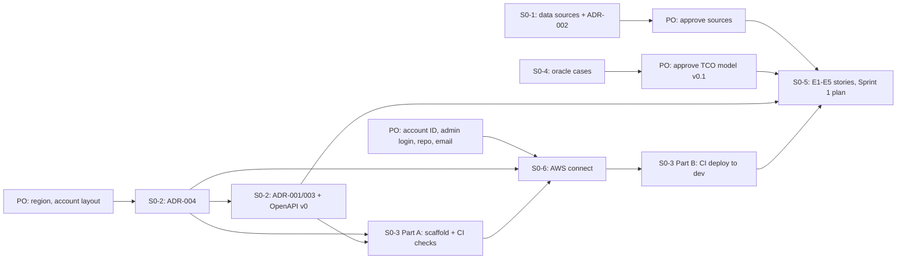

# Sprint 0 plan — Foundations

**Dates:** starts 2026-11-21 (target length: about 2 weeks, ends when all stories are accepted)
**PM:** Project Manager agent

## Goal
Lay the foundations so that Sprint 1 can build features: confirmed data sources, written architecture decisions and API contract, a secure connection to the AWS account, a repo with CI that deploys a "hello" app to `dev`, and oracle cases for the TCO model v0.1.

## Stories in execution order

Two tracks run in parallel. The critical path is **ADR-004 → S0-6 → S0-3 Part B**.

| # | Story | Owner | Depends on | Notes |
|---|---|---|---|---|
| 1 | [S0-2](../docs/stories/S0-2.md) ADR-004 first, then ADR-001, ADR-003, OpenAPI v0 | Architect | D-02 region, D-03 account layout, D-06 prod approver | ADR-004 is first because it decides the account/stage layout S0-6 needs |
| 1 | [S0-1](../docs/stories/S0-1.md) Validate data sources, ADR-002 | Architect | — | Parallel with S0-2. Largest risk item (licences, Danish coverage) |
| 1 | [S0-4](../docs/stories/S0-4.md) Oracle cases (hand-working) | Tester | TCO model v0.1 | Hand-working can start on day 1; harness waits for S0-3 Part A |
| 2 | [S0-3](../docs/stories/S0-3.md) Part A: scaffold, lint, test, synth in CI | Developer | ADR-001, ADR-004 | No AWS access needed |
| 3 | [S0-6](../docs/stories/S0-6.md) Connect AWS account: SSO/profile, `cdk bootstrap`, OIDC least-privilege role, budget alert | Developer + Architect (product owner gives access) | ADR-004, S0-3 Part A, D-01, D-04, D-05, D-07 | Done when "hello" deploys to `dev` locally and from CI |
| 4 | [S0-3](../docs/stories/S0-3.md) Part B: CI deploy step to `dev` on merge | Developer | S0-6 | Completes S0-3 |
| 4 | S0-4 harness wired into CI | Tester | S0-3 Part A, ADR-003 | Sign-off needs D-09 |
| 5 | [S0-5](../docs/stories/S0-5.md) Stories for E1–E5, Sprint 1 plan | Project Manager | S0-1, S0-2, S0-4, D-08, D-09 | Last item of the sprint |

Flow per story: Architect (design) → Developer → Architect (review) → Tester (PASS/FAIL) → PM accepts.

## What the product owner needs to provide (see `status/decisions-needed.md`)
- Day 2: region (D-02), account layout (D-03), prod approver (D-06)
- Day 3: AWS account ID + admin login (D-01), GitHub repo owner/name (D-04), budget email (D-05), budget confirmation (D-07)
- About day 6: approve data sources (D-08) and TCO model v0.1 (D-09); approve cost/region/stack ADRs as they arrive (D-10)

## Demo at the end of Sprint 0
The product owner can:
1. Open the `dev` URL and see the "hello" page in Danish, switch to English, and see a response from the "hello" API.
2. Watch a small PR go through GitHub Actions: lint, tests, `cdk synth`, then an automatic deploy to `dev` after merge, using OIDC (no stored AWS keys).
3. See the AWS budget alert (about 20 USD/month) in the AWS console, with their email subscribed.
4. Read `docs/data-sources.md` and ADR-001 to ADR-004 and approve or comment.
5. Check one oracle case by hand (e.g. EV vs. petrol) against the year-by-year `C(y)` table and its break-even year.
6. Review the proposed Sprint 1 plan.

## Risks
- **Data-source availability/licence (high).** Car specs matching (EEA/DMR to make/model/variant), PHEV split consumption and older used cars may have gaps. Fuel prices and insurance may need manual config. Mitigation: S0-1 runs from day 1; fallbacks are documented.
- **Danish tax-rule accuracy (high).** All rates are `TODO-VERIFY`. Oracle cases state their own assumed rates so they test formulas, not today's rates.
- **Access lead time (medium).** S0-6 and the CI deploy are blocked until the product owner provides account access, repo and email. Mitigation: S0-3 Part A and the other stories don't need AWS.
- **Region choice is hard to reverse (medium).** Decide before bootstrap.
