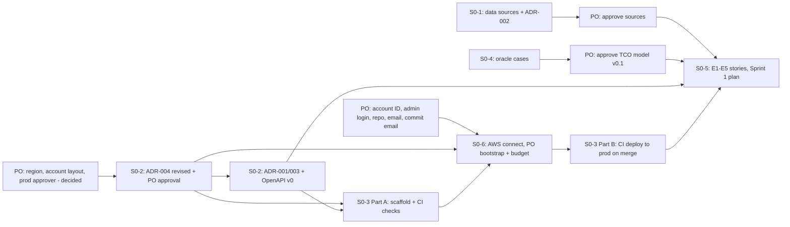

# Sprint 0 plan — Foundations

**Dates:** starts 2026-11-21 (target length: about 2 weeks, ends when all stories are accepted)
**PM:** Project Manager agent

## Goal
Lay the foundations so that Sprint 1 can build features: confirmed data sources, written architecture decisions and API contract, a secure connection to the AWS account, a repo with CI that deploys a "hello" app to `prod`, and oracle cases for the TCO model v0.1.

**Update 2026-11-21:** the product owner decided D-02 (region `eu-west-1`), D-03 (one AWS account, `prod` stage only, no `dev`) and D-06 (prod approval only from v1.0.0; until then merging to main deploys to `prod` automatically and agents may merge). The Architect is revising ADR-004 with these decisions; it awaits product owner approval (D-10). S0-6 and S0-3 Part B now target `prod`.

**Update 2026-11-21 (D-11 approved):** docs moved from `dev` to a single `prod` stage. No local deploys: the developer login is read-only and can run `cdk diff`; all `prod` changes go through CI from `main`; only the product owner's admin login deploys by hand, once, for the bootstrap. The budget alert is created manually by the product owner following the ADR-004 runbook (not in CDK). The repo is public on the GitHub Free plan (owner/name still open, D-04); commit author email must be fixed before the first push (D-12).

## Stories in execution order

Two tracks run in parallel. The critical path is **ADR-004 → S0-6 → S0-3 Part B**.

| # | Story | Owner | Depends on | Notes |
|---|---|---|---|---|
| 1 | [S0-2](../docs/stories/S0-2.md) ADR-004 first, then ADR-001, ADR-003, OpenAPI v0 | Architect | D-02, D-03, D-06 (resolved 2026-11-21); D-10 approval of revised ADR-004 | ADR-004 is first because it decides the account/stage layout S0-6 needs. Being revised with the product owner's decisions |
| 1 | [S0-1](../docs/stories/S0-1.md) Validate data sources, ADR-002 | Architect | — | Parallel with S0-2. Largest risk item (licences, Danish coverage) |
| 1 | [S0-4](../docs/stories/S0-4.md) Oracle cases (hand-working) | Tester | TCO model v0.1 | Hand-working can start on day 1; harness waits for S0-3 Part A |
| 2 | [S0-3](../docs/stories/S0-3.md) Part A: scaffold, lint, test, synth in CI | Developer | ADR-001, ADR-004 | No AWS access needed |
| 3 | [S0-6](../docs/stories/S0-6.md) Connect AWS account: read-only SSO/profile (`cdk diff`), one-time `cdk bootstrap` by the product owner, OIDC CI deploy role + read-only PR diff role, branch protection on `main`, budget alert (manual, product owner) | Developer + Architect (product owner: bootstrap and budget) | Approved ADR-004 (D-10), S0-3 Part A, D-01, D-04, D-05, D-07, D-12 | Done when CI deploys "hello" to `prod` (single account, `eu-west-1`) from `main`. No local deploys |
| 4 | [S0-3](../docs/stories/S0-3.md) Part B: CI deploy step to `prod` on merge to main (no approval gate before v1.0.0; PR checks must pass first) | Developer | S0-6 | Completes S0-3 |
| 4 | S0-4 harness wired into CI | Tester | S0-3 Part A, ADR-003 | Sign-off needs D-09 |
| 5 | [S0-5](../docs/stories/S0-5.md) Stories for E1–E5, Sprint 1 plan | Project Manager | S0-1, S0-2, S0-4, D-08, D-09 | Last item of the sprint |

Flow per story: Architect (design) → Developer → Architect (review) → Tester (PASS/FAIL) → PM accepts.

## What the product owner needs to provide (see `status/decisions-needed.md`)
- Done 2026-11-21: region `eu-west-1` (D-02), one account with `prod` only (D-03), prod approval from v1.0.0 (D-06), `dev` → `prod` doc changes, no local deploys and manual budget (D-11), repo public on GitHub Free (D-04, partly)
- Before the first push: commit author email decision (D-12)
- Most urgent, day 3: AWS account ID + admin login (D-01, coming shortly), GitHub repo owner/name (D-04), budget email (D-05) and thresholds (D-07)
- Day 2–4: approve revised ADR-004 (D-10)
- With S0-6: run the one-time admin bootstrap, and create the budget alert in the AWS console following the ADR-004 runbook, then confirm or send a screenshot
- About day 6: approve data sources (D-08) and TCO model v0.1 (D-09); approve other cost/region/stack ADRs as they arrive (D-10)

## Demo at the end of Sprint 0
The product owner can:
1. Open the `prod` URL and see the "hello" page in Danish, switch to English, and see a response from the "hello" API.
2. Watch a small PR go through GitHub Actions: lint, tests, `cdk synth`, then an automatic deploy to `prod` after merge, using OIDC (no stored AWS keys).
3. See that a direct push to `main` is rejected (branch protection), and that a PR shows a read-only `cdk diff`.
4. Check the AWS budget alert (about 20 USD/month) they created in the AWS console, with their email subscribed.
5. Read `docs/data-sources.md` and ADR-001 to ADR-004 and approve or comment.
6. Check one oracle case by hand (e.g. EV vs. petrol) against the year-by-year `C(y)` table and its break-even year.
7. Review the proposed Sprint 1 plan.

## Risks
- **Data-source availability/licence (high).** Car specs matching (EEA/DMR to make/model/variant), PHEV split consumption and older used cars may have gaps. Fuel prices and insurance may need manual config. Mitigation: S0-1 runs from day 1; fallbacks are documented.
- **Danish tax-rule accuracy (high).** All rates are `TODO-VERIFY`. Oracle cases state their own assumed rates so they test formulas, not today's rates.
- **Access lead time (medium).** S0-6 and the CI deploy are blocked until the product owner provides account access, repo and email, and runs the bootstrap. Mitigation: S0-3 Part A and the other stories don't need AWS.
- **Branch protection before first auto-deploy (medium).** Without it, a direct push to `main` would deploy to `prod`. Mitigation: branch protection is an S0-6 acceptance criterion and needs the repo owner/name (D-04).
- **Personal email in public history (medium).** The existing commits use a personal email address; pushing them to a public repo exposes it permanently. Mitigation: D-12 before the first push.
- **Region choice is hard to reverse (medium).** Decided 2026-11-21: `eu-west-1`. Bootstrap only after ADR-004 is approved.
- **No `dev` stage (medium).** Every merge before v1.0.0 deploys straight to `prod`. Mitigation: PR checks (lint, type-check, tests, `cdk synth`) must pass before merge; branch protection on `main` blocks direct pushes; nothing real is public before v1.0.0; feature flags from v1.0.0 (design by the Architect).
- **Prod approval gate at v1.0.0 (low).** GitHub environment required reviewers need a public repo or GitHub Enterprise. The repo is public on Free (D-04), so this is expected to work; the Architect confirms in ADR-004.
